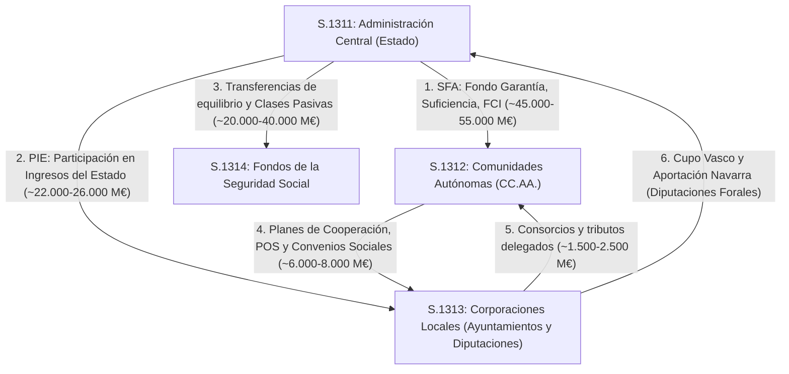

# Auditoría Técnica: Modelo de Contrapartes y Transferencias Interadministrativas (SEC-2010)

**Fecha:** Octubre 2026  
**Área:** Arquitectura de Datos / Contabilidad Nacional (SEC-2010)  
**Autor:** Senior Data Engineer & Systems Architect  

---

## 1. Alcance y Objetivo de la Auditoría

El presente informe evalúa si los datasets estándar de Eurostat y las fuentes oficiales de la IGAE (Intervención General de la Administración del Estado) incorporan de forma nativa campos de contraparte bilateral (sector institucional de origen y sector institucional de destino) para las operaciones de transferencias corrientes (`D.73`) y transferencias de capital (`D.92`), o si es necesario enriquecer el ETL con cuadros específicos de financiación interadministrativa.

---

## 2. Diagnóstico de los Datasets Actuales

### 2.1. Dataset Eurostat `gov_10a_main` (Cuentas Principales de las AA.PP.)
* **Dimensiones presentes:** `freq`, `unit`, `sector` (`S13`, `S1311`, `S1312`, `S1313`, `S1314`), `na_item` (`TR`, `TE`, `B9`, `D2REC`, `D5REC`, `D61REC`, `D91REC`), `geo` (`ES`), `time`.
* **Hallazgo:** Los registros se publican a nivel de subsector individual (datos consolidados y no consolidados). **No existe dimensión de contraparte (`counterpart_sector`)**.
* **Implicación técnica:** Eurostat informa del total de transferencias pagadas (`D73PAY`) o recibidas (`D73REC`) por cada subsector, pero **no proporciona la matriz de cruce $S_{\text{origen}} \times S_{\text{destino}}$** (es decir, no desagrega en Eurostat cuánto de las transferencias recibidas por las Corporaciones Locales proviene del Estado y cuánto de las Comunidades Autónomas).

### 2.2. Dataset Eurostat `gov_10a_exp` (Gasto por Funciones COFOG)
* **Dimensiones presentes:** `freq`, `unit`, `sector`, `cofog99`, `na_item` (`TE`), `geo`, `time`.
* **Hallazgo:** Clasifica el gasto final por finalidad funcional (`GF01` a `GF10`). Al ser gasto final consolidado, no refleja los flujos financieros intermedios entre administraciones (las transferencias entre subsectores se consolidan al calcular el total `S13`).

---

## 3. La Fuente Oficial para Matrices de Contraparte: La IGAE

Para modelar con exactitud matemática el origen y destino del dinero interadministrativo, la fuente oficial de referencia en España es la **IGAE**:

> **"Cuentas Consolidadas del Sector Administraciones Públicas: Operaciones No Financieras entre Subsectores (SEC-2010)"**

Esta publicación de la IGAE detalla la **Matriz Bilateral de Transferencias Interadministrativas**, que se desglosa en cinco grandes canales:

### Detalle de los 5 Canales Clave:
1. **Canal Estado $\to$ CC.AA. (`S1311` $\to$ `S1312`):**
   * **Mecanismo:** Sistema de Financiación Autonómica (SFA).
   * **Partidas:** Fondo de Garantía de Servicios Públicos Fundamentales (FGSPF), Fondo de Suficiencia Global, Fondos de Convergencia (Competitividad y Cooperación), y Fondo de Compensación Interterritorial (FCI).
   * **Importancia:** Financia entre el 30% y el 65% de los presupuestos de las CC.AA. de régimen común (mayor dependencia en Extremadura, Andalucía o Castilla-La Mancha).
2. **Canal Estado $\to$ Corporaciones Locales (`S1311` $\to$ `S1313`):**
   * **Mecanismo:** Participación en los Ingresos del Estado (PIE).
   * **Importancia:** Es el pilar maestro de las Diputaciones Provinciales de régimen común (supone entre el **65% y el 75%** de todos sus ingresos).
3. **Canal CC.AA. $\to$ Corporaciones Locales (`S1312` $\to$ `S1313`):**
   * **Mecanismo:** Planes Provinciales de Cooperación de Obras y Servicios (POS), subvenciones finalistas de servicios sociales (residencias concertadas y dependencia) y convenios de empleo.
   * **Importancia:** Supone entre el **10% y el 15%** de los ingresos de las Diputaciones y Ayuntamientos.
4. **Canal Estado $\to$ Seguridad Social (`S1311` $\to$ `S1314`):**
   * **Mecanismo:** Transferencias extraordinarias anuales aprobadas en los Presupuestos Generales del Estado (PGE) para financiar gastos impropios de la Seguridad Social, pensiones no contributivas y el Ingreso Mínimo Vital (IMV).
5. **Canal Singular Foral (Diputaciones Forales de Euskadi y Navarra $\to$ Estado y Gobierno Vasco):**
   * En el País Vasco, las 3 Diputaciones Forales recaudan el 100% de los impuestos en Álava, Bizkaia y Gipuzkoa. Transfieren fondos hacia arriba al Gobierno Vasco (`S1312`) y abonan el **Cupo** al Estado central (`S1311`) por las cargas generales no asumidas (Defensa, Corona, representación exterior).

---

## 4. Recomendación de Arquitectura de Datos

1. **Corto Plazo (Fase 4 - Nivel 3):**
   * Incorporar en el ETL de Diputaciones y Cabildos (`process_diputaciones.py`) el desglose explícito de los ingresos por origen de contraparte:
     * `% Transferencias del Estado (PIE)`
     * `% Transferencias de la Comunidad Autónoma`
     * `% Ingresos Tributarios Propios y Tasas`
2. **Medio Plazo (Fase 5 - Módulo de Financiación Interadministrativa):**
   * Crear un dataset complementario `data/processed/flujos_interadministrativos_sec2010.json` alimentado de los cuadros anuales de transacciones no financieras de la IGAE.
   * Implementar en el frontend un diagrama de Sankey de **Flujos entre Administraciones** que permita visualizar cómo el dinero recaudado por la Agencia Tributaria (AEAT) se reparte hacia el Estado, las 17 Comunidades Autónomas, las 50 Diputaciones y los más de 8.000 Ayuntamientos.
